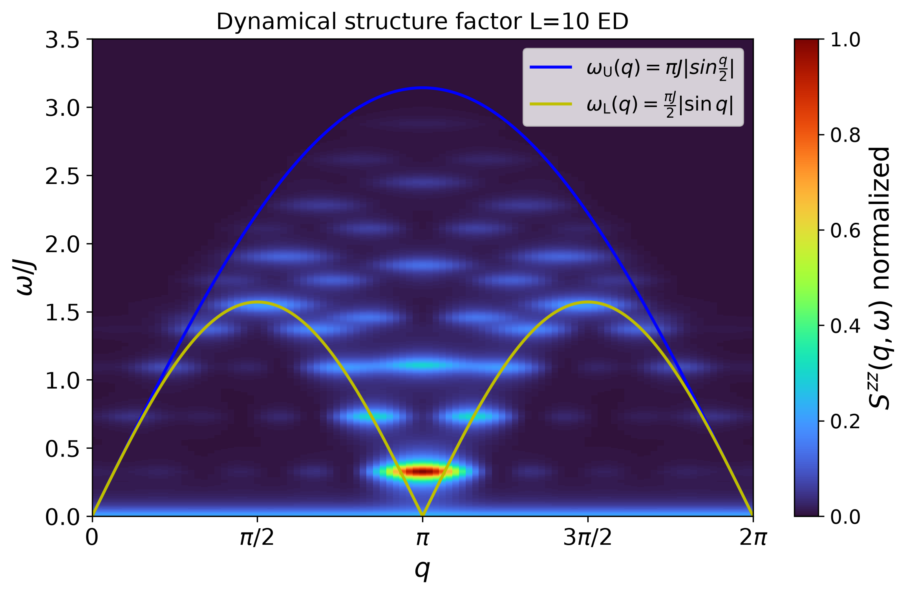
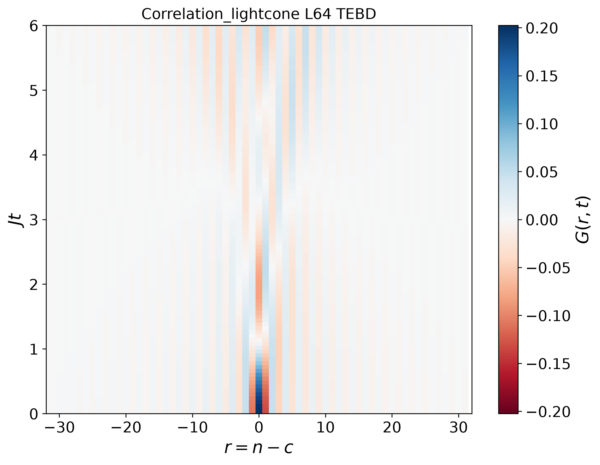
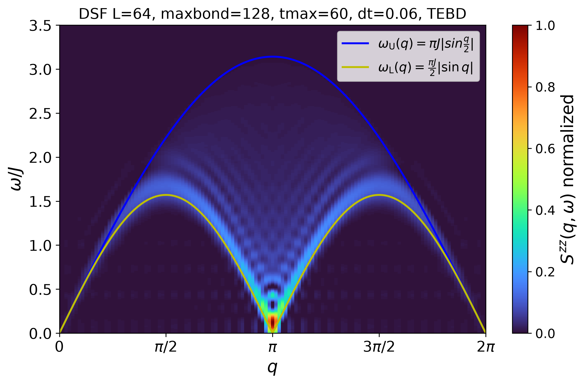

# Dynamical Structure Factor $S(q,\omega)$

This repository contains Python codes to calculate the dynamical structure factor $S(q,\omega)$ of the 1D spin-1/2 Heisenberg model using exact diagonalization (ED) and time-evolving block decimation (TEBD).

## Physical Background

Inelastic neutron scattering probes magnetic excitations as a function of momentum transfer $q$ and energy transfer $\omega$.

The dynamical structure factor (DSF), $S(q,\omega)$, characterizes spin correlations resolved in momentum and energy. It is related to the space- and time-dependent spin correlation function $G(r,t)$ through a Fourier transform:

$$
S(q,\omega)\propto
\sum_r\int dt\,e^{i(\omega t-qr)}G(r,t)
$$

The precise normalization and Fourier-transform convention depend on the definition of $G(r,t)$.

## Model: 1D Spin-1/2 Heisenberg Model

The 1D spin-1/2 Heisenberg Hamiltonian is following:

$$
H=J\sum_{i=1}^{L-1}
\mathbf{S}_i\cdot\mathbf{S}_{i+1}
$$

where $J>0$ is the antiferromagnetic exchange coupling. \
Open boundary conditions (OBC) are used.

## ED: 8 Sites

Calculate $S(q,\omega)$ for a chain of $L=8$ sites using exact diagonalization.

Calculation flow:

1. Construct the Hamiltonian $H$.
2. Diagonalize $H$ to obtain the ground state $|\psi_0\rangle$ and energy eigenstates $E_0$.
3. Calculate the dynamical structure factor $S(q,\omega)$.

ED provides an accurate reference for small systems, but the computational cost increases rapidly with system size.

## TEBD: 64 Sites

Calculate $S(q,\omega)$ for a chain of $L=64$ sites using DMRG and TEBD.

Calculation flow:

1. Construct the Hamiltonian $H$.

2. Obtain the ground state $|\psi_0\rangle$ and ground-state energy $E_0$ using DMRG.

3. Apply a local spin operator at the central site $c$:

$$
|\phi(0)\rangle=S_c^z|\psi_0\rangle
$$

4. Evolve the resulting state in time using TEBD:

$$
|\phi(t)\rangle=e^{-iHt}|\phi(0)\rangle
$$

5. Calculate the time-dependent spin correlation function:

$$
G(n,c;t)=e^{iE_0t}\langle\psi_0|S_n^z|\phi(t)\rangle
$$

6. Fourier transform the spatial coordinate to obtain $G(q,t)$.

7. Fourier transform time to obtain $S(q,\omega)$.

TEBD uses a matrix product state (MPS) representation to simulate the time evolution of a larger system than is typically accessible with ED.

## Numerical Considerations
$L$ = 8 (ED), 64 (TEBD) \
$J$ = 1.0 \
$c = L / 2 $\
$t_{max} = 20 $\
$dt = 0.05 $\
$dt_{obs} = dt $\
For the temporal Gaussian window

$$
W(t)=e^{-t^2/(2\sigma_t^2)},
\qquad \sigma_t=t_{\max}/3
$$

## Comparison: ED and TEBD

ED treats small systems directly, whereas DMRG+TEBD enables simulations of larger chains using MPS. Comparing their results can help assess finite-size effects and validate the TEBD calculation.

